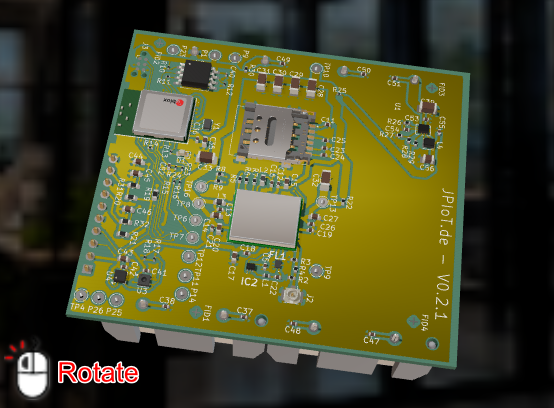

# JoEmbedded 3D Viewer

A browser-based GLTF/GLB viewer for circuit boards, sensors and product models.
The demos use **Three.js**, mouse/touch orbit controls and optional
image or Video-MP4 skyboxes. No build step is required. "Just works":



## Demos

Every HTML entry point is listed below. **Open demo** links target GitHub Pages;
**Source** links open the HTML in this repository. Updated Pages URLs become
available after the reorganized files are published to GitHub Pages.

| Page | Purpose | Open demo | Source |
| --- | --- | --- | --- |
| `index.html` | Entry page with links to all demos, a RAK3172 module and a compact material sample | [Open demo](https://joembedded.github.io/viewer3d/index.html) | [Source](index.html) |
| `skybox-explorer.html` | Scientific logger with all six image panoramas and the MP4 skybox | [Open demo](https://joembedded.github.io/viewer3d/skybox-explorer.html) | [Source](skybox-explorer.html) |
| `jpiot-pcb.html` | JPIoT circuit board with studio lighting and soft contact shadows | [Open demo](https://joembedded.github.io/viewer3d/jpiot-pcb.html) | [Source](jpiot-pcb.html) |
| `scientific-logger.html` | Scientific logger in its laboratory panorama | [Open demo](https://joembedded.github.io/viewer3d/scientific-logger.html) | [Source](scientific-logger.html) |
| `material-preview.html` | Polished aluminium, polymer and satin-metal sample | [Open demo](https://joembedded.github.io/viewer3d/material-preview.html) | [Source](material-preview.html) |
| `ble-sensor.html` | OSX sensor orientation controlled by a Bluetooth device | [Open demo](https://joembedded.github.io/viewer3d/ble-sensor.html) | [Source](ble-sensor.html) |

The former `index2.html`, `jpiot.html`, `boilerplate_gp.html`,
`boilerplate_sg.html` and `boilerplate_gp_video.html` have been renamed to the
corresponding descriptive pages above. Update existing bookmarks and embeds.
Every page uses a centered 90% content width, leaving 5% on the left and right
of the available viewport (excluding the scrollbar). The shared rules live in
`driver_js/page-layout.css`. Each page includes a "Zurück" link to `index.html`.
The introductory and Bluetooth pages also retain 5vh top and bottom padding;
compact viewers shrink to fit narrow screens.

## Repository layout

```text
*.html                    Demo entry points
models/                   GLB models and optional same-name JSONL presentations
  source/                 Editable Three.js project and its source artwork
skyboxes/                 Panorama images and MP4 videos
driver_js/               Viewer, Bluetooth drivers and shared styles
  three/                  Minimal local Three.js runtime and required add-ons
tools/                   Asset generation and verification utilities
favicon.ico               Site icon
LICENSE                   Project license
readme.md                 Documentation and demo links
```

Temporary browser reports, screenshots, caches and local backups are excluded
from version control. Unused Three.js add-ons and historical output files have
been removed from the active project. Required runtime libraries retain their
copyright/license headers.

## Run locally

Serve the repository root over HTTP. For XAMPP, open
`http://localhost/viewer3d/index.html`. Alternatively:

```sh
python -m http.server 8765
```

Then open `http://localhost:8765/index.html`. Loading ES modules and models via
`file://` is not supported. Asset paths are relative to the HTML document, so
the same layout works under a GitHub Pages project subdirectory.

## Embed a viewer

Add a container with an explicit height, the stylesheet and this import map:

```html
<link rel="stylesheet" href="./driver_js/jo3dview.css">
<script type="importmap">
{
  "imports": {
    "three": "./driver_js/three/build/three.module.min.js",
    "three/addons/": "./driver_js/three/examples/jsm/"
  }
}
</script>
<div id="viewer-controls"></div>
<div id="mviewer" class="jo3dviewer" style="height: 60vh">
  <div id="mloader" class="jo3dloader" role="status">Loading...</div>
</div>
```

Initialize it from a module script:

```js
import { view3dDocumentation } from './driver_js/jo3dview.js';

const viewer = view3dDocumentation('mviewer', {
    model: './models/testball-optimized.glb',
    background: './skyboxes/southern-germany.webp',
    loaderId: 'mloader',
    toolbarId: 'viewer-controls', // optional
    autoRotatePause: 10
});
await viewer.ready; // model loaded; rejects on model-loading errors
await viewer.backgroundReady; // true on background load, false on failure

// viewer.setAutoRotate(false);
// viewer.setNeutralBackground(true); // preserves environment lighting
// viewer.resetView();
// viewer.invalidate(); // after manual scene/material changes
// viewer.dispose(); // releases resources when removing the viewer
```

For a minimal integration, `view3d(containerId, model, size, loaderId,
background, centerModel, options)` remains available. Its seventh argument
accepts the rendering options used by the documentation preset.

The preset uses ACES tone mapping, exposure 1.05, environment intensity 1.25,
background intensity 0.85 and normalized model size 1.1. Override `exposure`,
`environmentIntensity`, `backgroundIntensity`, `fov`, `size` and
`cameraPosition: [x, y, z]` as needed. The camera adapts to portrait screens.
Rotation defaults to off when reduced motion is requested. Interaction pauses
auto-rotation for 10 seconds after release. Hidden/offscreen views skip rendering;
stationary documentation viewers render only when necessary. Pixel ratio is
capped at 1.75 and the drawing buffer at 3 million pixels by default.

Optional `modelAutoRotateSpeed: [x, y, z]` adds model rotation around each Euler
axis while camera auto-rotation is active. It defaults to `[0, 0, 0]` (disabled) and uses the same
units as `autoRotateSpeed`: `1` is one full turn per 60 seconds; negative values
reverse direction. The extra rotation follows the same interaction pauses,
rotation toggle and visibility handling. The Scientific logger uses
`autoRotateSpeed: -0.35` and `modelAutoRotateSpeed: [-0.175, 0, 0]` (half speed
around X). The Skybox Explorer uses `[0, -1.5, 0]` for rotation around Y.
Each zero component disables its axis. Older scalar values remain
supported as an X-only speed.

## Flight Recorder and presentations

Every viewer has a compact **Record** developer button that opens the non-modal
Flight Recorder editor. Each viewer owns its own point list. Opening the editor switches off
auto-rotation; the canvas remains available for setting up the next shot.

Presentation files live **in the same directory as their model**, with the same
base filename and the extension **`.jsonl`**. For example:

| Model | Presentation data |
| --- | --- |
| `models/view3d_opt.glb` | `models/view3d_opt.jsonl` |
| `models/rak3172sip.glb` | `models/rak3172sip.jsonl` |

On initialization, each viewer checks its companion file with an HTTP `HEAD`
request. The **Presentation** button is initially hidden and appears only if
that request succeeds. A missing or unreachable file leaves it hidden; there is
no fallback to another model's presentation. Serve the JSONL files alongside the
models, including when publishing to GitHub Pages, then reload the page after
adding a file. Viewers using the same model use the same companion file.

**Presentation** loads the file without a prompt, waits for the model and flies
to the first point. It closes the editor on success; the Info box and navigation
appear after arrival. The button remains available when the **Record** launcher
is hidden. Override the derived file with `data-presentation-file="my-tour.jsonl"`
on the viewer container or the `presentationFile` viewer option (which takes
precedence). Paths are relative to the HTML page. An invalid, empty or failed load
shows an error in the editor and retains the existing points. Reset, Auto or
disposal cancel a pending load.

- **View loggen** asks for a short name, records the current view and adds a
  destination button. Each point has an editable **Info** field initially set
  to `Name-YourCommentsHere`. Canceling or entering a blank name adds nothing.
  **V** on the focused canvas records a point too. Each recording is also logged
  as JSON in the browser console.
- **Edit** beside each point opens a prompt with its existing Info text. Use
  `\n` for a line break. Cancel keeps the old text; an empty value clears it.
  Each row also displays the recorded zoom factor and camera-to-target distance.
- Click a point's button to fly smoothly to it. Camera position, look target,
  orientation, FOV, zoom and the recorded model transform transition together.
  Camera-relative interpolation produces an orbit around the target. The final
  view stays still for presenting. Mouse/touch interaction cancels a flight;
  choosing another point starts from the current position. Normal rotation can
  be enabled again using **Auto**, the existing rotation control or `viewer.setAutoRotate(true)`.
- After arrival, the Info text fades into a readable box at the top left of the
  viewer. Both literal `\n` escapes and real line breaks are displayed as new lines.
  Its four navigation buttons are **⏮ START** (first list point), **‹** (previous),
  **›** (next) and **⏹ END** (close the box, fly back to the app's initial view,
  then restart auto-rotation).
  Previous/next are disabled at the list boundaries. The box hides during a flight
  or manual interaction, and reappears after the next arrival.
- On browser viewports **up to 1024 px wide or up to 600 px high**, the Info box
  starts expanded at each arrival and collapses after **2 seconds** into a small
  navigation bar. All four navigation controls remain accessible. The **▲/▼**
  toggle is always available, including on larger screens, to collapse or expand
  the text manually. Manually reopened text stays open until the next point or a
  change across the responsive breakpoint. Larger viewports stay expanded by
  default. Box resizing and the toggle use a soft **320 ms** animation, disabled
  when the browser requests reduced motion.
- **Auto** ends the current flight or stationary presentation view, flies back to
  the app's initial camera position, target, zoom and model pose, and only then
  restarts auto-rotation. This is the app's starting view, not the first point in
  the loaded file or the view before pressing Presentation. Scripts can call
  `viewer.flightRecorder.startAutoRotation()`. Manual interaction, Reset or a new
  flight cancels the return without starting auto-rotation later.
  Long point lists scroll vertically inside their frame; the toolbar stays visible.
- **Reset** clears the list immediately and cancels an active flight or import.
- **Export** downloads UTF-8 JSONL: one named point per line, including Info.
  Before a file has been loaded, the suggested download name is the model's
  companion filename, e.g. `view3d_opt.jsonl`. After loading, it uses that file's
  basename. Save/copy the download next to the corresponding model with the same
  basename and `.jsonl` extension to make it available through **Presentation**.
  Export does not write to the web server automatically.
- **Laden** prompts for a project filename (including `.jsonl`, or a relative
  path), initially suggesting the same file as **Presentation**, then the last
  successfully loaded filename. It loads using `fetch()`, relative to the HTML page. A valid file
  replaces the list. Errors are shown in the editor and retain the existing list.
  An empty file loads an empty list. Lists are held in memory; export before
  reloading or leaving the page.

The **Record** button is visible by default. Every demo marks its viewer container with
`data-flight-recorder="visible"`; change it to `hidden` in the HTML to hide it:

```html
<div id="mviewer" class="jo3dviewer" data-flight-recorder="hidden"></div>
```

Alternatively pass `flightRecorder: false` in the viewer options, or set
`viewer.flightRecorder.button.hidden = true`. Hiding the button only hides the
launcher; programmatic access and the canvas shortcut remain available.

`TRANSTIME` in `driver_js/flight-recorder.js` defaults to **2.0 seconds per scene
unit** (twice the original flight speed). Override it per viewer with `transTime: 2.0` in the options. Duration is
`d = max(cameraDistance, targetDistance, 0.25)` and
`duration = transTime * (d <= 1 ? d : sqrt(d))`, with smooth acceleration
and deceleration. Short flights keep their original timing; at the default setting,
a distance of 4 takes 4 seconds instead of 8. The minimum gives zoom/orientation-only changes a half-second
transition at the default setting. Flights pause while the viewer/tab is hidden.

Each JSONL record has `version: 1`, `name`, `info` and the snapshot fields:
`viewerId`, `camera`, `viewport`, `model`. Camera data includes position, target,
up vector, quaternion (`[x, y, z, w]`), vertical FOV (degrees), zoom, distance, near/far and
aspect. Model data includes position, quaternion and scale. Vectors use
`[x, y, z]` in scene units. The recorded viewport dimensions and aspect are
metadata; playback uses the current browser dimensions. Use points with the
same model and initial scale, and wait for the intro animation before recording.
Mouse wheel/OrbitControls zoom changes the camera distance, usually leaving `zoom`
at 1. Both values are restored during playback. Old files without `distance`
remain supported: it is derived from position and target. Editing `distance` in
JSONL changes the camera distance along the stored viewing direction.

Both viewer constructors expose the same API:

```js
const snapshot = viewer.getViewport(); // fresh plain-value snapshot
viewer.logViewport();                 // console-only snapshot, without a prompt
viewer.flightRecorder.record();       // prompt for a named point
const points = viewer.flightRecorder.points; // independent copy of the current list
viewer.flightRecorder.flyTo(points[0]);       // returns duration in seconds
viewer.flightRecorder.flyTo(0);               // first point by list index, with navigation
viewer.flightRecorder.stop();                // cancel the current flight
viewer.flightRecorder.startAutoRotation();   // fly to initial view, then resume rotation
await viewer.flightRecorder.startPresentation(); // load model's JSONL companion and start first flight
// await viewer.flightRecorder.startPresentation('my-tour.jsonl'); // optional filename
viewer.flightRecorder.reset();               // clear the list
```

## Skyboxes and background selection

Put equirectangular panorama images and videos in `skyboxes/`. Full 360-degree
panoramas normally have a 2:1 aspect ratio. `skybox-explorer.html` lists the
available assets in its `backgrounds` array with per-environment light levels.
Add an entry there when adding a new skybox. Neutral camera-relative lights
keep labels readable while the selected panorama supplies metal reflections.

Switch backgrounds without reloading the model or resetting the camera:

```js
const loaded = await viewer.setBackground('./skyboxes/industrial_skybox.mp4', {
    environmentFallbackImage: './skyboxes/industrial_skybox.png'
});
```

The returned promise resolves to `true` on load or `false` on failure or
supersession. Old textures/video decoders are released, and late image responses
cannot overwrite a newer selection. `viewer.backgroundReady` always refers to
the latest load.

### MP4 playback and reflections

MP4 skyboxes loop muted and inline. Playback pauses when the tab/viewer is
hidden or the neutral background is selected. If autoplay is blocked, a click,
touch or key press inside the viewer retries playback. `viewer.backgroundVideo`
exposes the video element for custom controls. Browser-supported video codecs
are required; cross-origin media must permit CORS.

Reflections use the first available video frame, captured once at up to 1024
pixels wide. If capture is unavailable, the driver tries the same filename with
a `.PNG` extension. `environmentFallbackImage` overrides this path; use the
actual filename case on case-sensitive servers. An explicit `environmentImage`
can instead select a static reflection image from the start. No environment map
is regenerated per frame. A failed video uses a neutral background and invokes
`onBackgroundError`, while preserving available environment lighting.

Video backgrounds use an independent perspective camera: `backgroundFov`
defaults to 60 degrees before aspect adjustment, with `maxBackgroundFov: 85`
limiting both axes. This shows more room without a fisheye projection or changing
model framing. These controls apply to video; still panoramas use the model
camera. `backgroundBlurriness` applies to static image panoramas.

## Bluetooth sensor

Open `ble-sensor.html` using a browser with Web Bluetooth support on HTTPS or
localhost. A compatible OSX orientation sensor is required for live data.

1. Click **Connect** and choose the device.
2. If a PIN is required, enter `.i PIN` in the terminal once; it is stored locally.
3. Click **Start** to follow the physical sensor orientation (allow about 5 seconds).
4. Click **Stop** to stop the sensor stream.

The terminal uses `driver_js/blx.js`, `driver_js/blStore.js` and
`driver_js/FileSaver.js`. Real hardware communication must be checked with a
connected sensor; browser-only smoke checks do not verify a Bluetooth link.

## Model sources and asset generation

`models/source/three_editor_project.json` and `models/source/logo.png` preserve
the editable model source. `models/testball.glb` is the original material sample;
`models/testball-optimized.glb` removes the masonry bump and blue emission and
uses polished aluminium, red polymer and satin metal. Both are used by demos.

Rebuild the optimized sample using the Python standard library:

```sh
python tools/optimize-demo.py
```

Optionally regenerate the Southern Germany WebP from a supplied original image
(requires Pillow):

```sh
python tools/optimize-demo.py --panorama path/to/original-panorama.jpg
```

The panorama is limited to 2560 x 1280 pixels and encoded at WebP quality 85.
The original high-resolution photograph is not required for normal operation.
These LDR panoramas provide reflections but do not reproduce the full lighting
range of an HDR environment.

## Browser checks

With XAMPP serving `http://localhost/viewer3d/` and Playwright CLI installed,
run these commands from the repository root (PowerShell):

```powershell
New-Item -ItemType Directory -Path output/playwright -Force
playwright-cli -s=viewer open http://localhost/viewer3d/index.html --headed
playwright-cli -s=viewer run-code --filename=tools/check-pages.js
playwright-cli -s=viewer run-code --filename=tools/check-backgrounds.js
playwright-cli -s=viewer run-code --filename=tools/check-model-rotation.js
playwright-cli -s=viewer run-code --filename=tools/check-flight-recorder.js
playwright-cli -s=viewer run-code --filename=tools/check-flight-presentation.js
playwright-cli -s=viewer run-code --filename=tools/check-presentation-start.js
playwright-cli -s=viewer run-code --filename=tools/check-presentation-responsive.js
```

The checks load every page at desktop and mobile widths, verify the 5% demo
padding, test all skyboxes and cover video loops, fallback reflections, rapid
background changes and cleanup. The model-rotation check verifies half speed,
pause/resume, visibility, reduced motion and the disabled default.
The Flight Recorder check covers recording, editing Info, JSONL download/import,
smooth flight and interruption, invalid files, mobile layout and viewer isolation.
The presentation check also exercises mouse wheel and optical zoom after import,
the Edit prompt, multiline Info, navigation and ending a presentation.
The presentation-start check loads the JPIoT tour and verifies the first point,
short/long timing, file overrides, model readiness, cancellation and load errors.
The responsive-presentation check verifies companion-file availability and button
visibility on all demos, the two-second delay, manual expansion, navigation and
cleanup at desktop, tablet, phone and short landscape viewport sizes.
Screenshots go to the ignored `output/` folder.

## Dependencies and license

The retained [Three.js](https://threejs.org/) subset contains its two runtime
modules, OrbitControls, GLTFLoader and BufferGeometryUtils. Bluetooth support
and FileSaver are also bundled locally. See the source license headers and the
project [MIT license](LICENSE).
